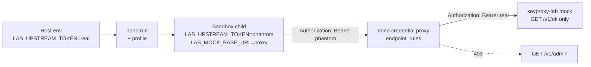

# minilab-nono-key-proxy

Built by SkilledDragon LLC — architecture-led software engineering — [skilleddragon.com](https://skilleddragon.com)

Palette: `#020617` / `#040F49` / `#006BDF` / `#00BFA6`

## 1. What we built and why (the candado)

Same week Anthropic published [Strengthening our defenses against distillation attacks](https://www.anthropic.com/research/distillation-defenses) (2026-10-12) and GitHub [started blocking Anthropic API keys by default in secret scanning](https://github.blog/changelog/2026-10-13-secret-scanning-blocks-anthropic-keys-by-default-adds-salesforce) (2026-10-13), the lesson for builders was clear: put a lock (**candado**) on your own agent.

Vendor claims from Anthropic (hedge them — they are Anthropic’s numbers, not ours): reasoning tokens extracted by distillers fell ~90–99%, a two-stage classifier runs at &lt;0.1% false positives, and tens of thousands of accounts were banned. Regardless of those percentages, the operational pattern we want is mechanical: **the agent process never holds the real token**.

This minilab proves that pattern with [nolabs-ai/nono](https://github.com/nolabs-ai/nono) **v0.80.0** (`8bb041356d48f771a221e58c98d9b1ff442e76fe`):

- Agent command runs inside nono’s kernel sandbox (Landlock on Linux ≥ 5.13, Seatbelt on macOS).
- Outbound API calls go through nono’s **credential proxy**.
- The sandbox only sees a **phantom** token; the proxy swaps it for the real secret and enforces `endpoint_rules`.

## 2. What we tested

| Slice | Command | Notes |
| --- | --- | --- |
| Lab unit | `cargo test --workspace --locked --lib` | Mock HTTP + profile writer |
| Lab e2e | `cargo test --workspace --locked --test e2e -- --test-threads=1` | Real `nono` binary, keyless random token |
| Upstream verbatim | `.github/workflows/upstream-ci.yml` | Jobs `test` / `integration` / `fmt` / `clippy` / `audit` at the pin |
| Parity | `cargo run --manifest-path scripts/check-upstream-parity/Cargo.toml` | Diffs every `run:` script vs `ci/upstream/ci.yml` |
| Layout / secrets | `bash scripts/check-skills`, gitleaks `v8.30.1`, `cargo audit --deny warnings` | |

Flags cited from upstream `crates/nono-cli/src/cli.rs` at the pin: `--allow-cwd`, `--profile` / `-p`, `--credential`, `--allow-endpoint`, `--block-net`, `nono profile validate --strict`.

See [RESULTS.md](RESULTS.md) for pass counts, durations, `nono --version`, and CI run URL (filled after the green push).

## 3. Setup

```bash
git clone --recurse-submodules https://github.com/SkilledDragonCorp/minilab-nono-key-proxy.git
cd minilab-nono-key-proxy
git -C upstream rev-parse HEAD
# must print 8bb041356d48f771a221e58c98d9b1ff442e76fe

rustup show
cargo install --locked nono-cli --version 0.80.0
nono --version

cargo test --workspace --locked --lib
cargo test --workspace --locked --test e2e -- --test-threads=1
bash scripts/report.sh
```

### Tutorial (expected output)

```bash
export LAB_UPSTREAM_TOKEN="$(openssl rand -hex 32)"
export NONO_NO_UPDATE_CHECK=1
export NONO_NO_SAVE_PROMPT=1

# Terminal A — mock upstream (prints the chosen port)
cargo run --locked -p keyproxy-lab -- serve-mock --port 0

# Terminal B — profile + validate + sandboxed curl
PORT=<port-from-terminal-A>
WORKDIR="$(mktemp -d)"
FAKE_HOME="$(mktemp -d)"
cargo run --locked -p keyproxy-lab -- profile \
  --mock-port "$PORT" \
  --workdir "$WORKDIR" \
  --fake-home "$FAKE_HOME" \
  --out /tmp/keyproxy-lab.profile.json
nono profile validate --strict /tmp/keyproxy-lab.profile.json
nono run --profile /tmp/keyproxy-lab.profile.json --workdir "$WORKDIR" --allow-cwd -- \
  sh -c 'curl -s -o body -w "%{http_code}" -H "Authorization: Bearer $LAB_UPSTREAM_TOKEN" "$LAB_MOCK_BASE_URL/v1/ok"; echo; cat body'
```

Expected: HTTP `200` and JSON containing `keyproxy-lab-mock`. Inside the sandbox, `echo "$LAB_UPSTREAM_TOKEN"` must **not** equal the host token.

### Architecture



## 4. Using these skills in Claude Code and Cursor

Both tools auto-discover `.claude/skills/<name>/SKILL.md` from the repo root.

| Skill folder | Invoke |
| --- | --- |
| `run-agent-behind-key-lock` | Ask Claude Code / Cursor: “use the run-agent-behind-key-lock skill” |

Do **not** create `.cursor/skills` or `.agents/skills` mirrors — CI `skills-layout` fails if they exist.

## 5. API keys

| Variable | Required | Where / cost | Used by | Minimum scopes |
| --- | --- | --- | --- | --- |
| `LAB_UPSTREAM_TOKEN` | Yes for `serve-mock`; e2e mints its own | Local random hex | Mock + proxy | N/A (lab secret) |
| `GITHUB_TOKEN` | Optional live demo | GitHub fine-grained PAT — free | nono proxy only | Metadata: read-only |
| `NONO_NO_UPDATE_CHECK` | Recommended | Set to `1` | nono CLI | Opt-out |
| `NONO_NO_SAVE_PROMPT` | Recommended | Set to `1` | nono CLI | Opt-out |
| `NONO_NO_MIGRATE` | Recommended | Set to `1` | nono CLI | Opt-out |
| `NONO_NO_PACK_UPDATE_HINTS` | Recommended | Set to `1` | nono CLI | Opt-out |
| `DO_NOT_TRACK` | Recommended | Set to `1` | general | Opt-out |

Identical names with empty values: [`.env.example`](.env.example).

Telemetry / opt-out scan at the pin:

```bash
rg -n -i "telemetry|analytics|NONO_[A-Z_]*" upstream/crates upstream/README.md
```

Documented NONO_* opt-outs used here: `NONO_NO_UPDATE_CHECK`, `NONO_NO_SAVE_PROMPT`, `NONO_NO_MIGRATE`, `NONO_NO_PACK_UPDATE_HINTS`. Also seen in upstream sources: `NONO_KEYRING_TIMEOUT_SECS`, `NONO_PROFILE`, `NONO_CREDENTIAL`, `NONO_BLOCK_NET`, `NONO_THEME`, `NONO_LOG_FILE`, `NONO_SUPERVISOR_PATH`, `NONO_PROXY_TOKEN`.

## 6. License

- This lab: **Apache-2.0** (see [LICENSE](LICENSE)).
- Upstream `nolabs-ai/nono`: **Apache-2.0** (see `upstream/LICENSE`), pin `v0.80.0` / `8bb041356d48f771a221e58c98d9b1ff442e76fe`.
